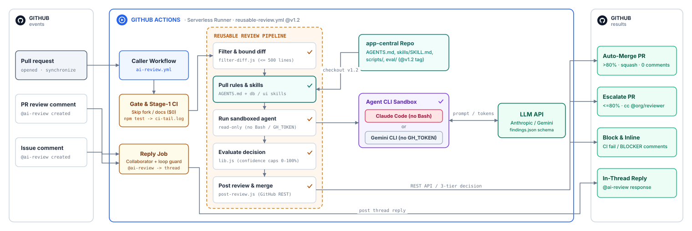
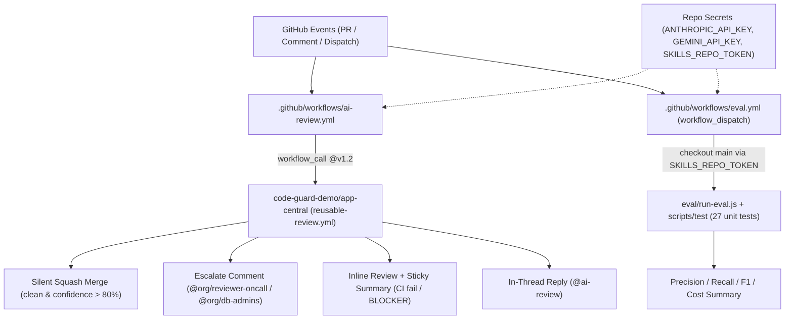

# app-monkey

Target Node.js application repository consuming the centralized AI PR reviewer in [`code-guard-demo/app-central`](https://github.com/code-guard-demo/app-central).

## Local Usage

Requires Node.js 20+ (no external npm dependencies):

```bash
npm run lint   # runs `node --check sum.js`
npm test       # runs `node --test`
```

Current utilities in `sum.js`:
- `average(arr)` — arithmetic mean helper
- `getName(user)` — safe nested name lookup
- `clamp(val, min, max)` — range clamping with `RangeError` guard (added and auto-merged by AI review in `PR #21`)

## Workflows & Secrets



> Editable source: [docs/architecture.drawio](./docs/architecture.drawio) (open in [app.diagrams.net](https://app.diagrams.net/) or the VS Code Draw.io extension).



- **`.github/workflows/ai-review.yml`** — Calls `code-guard-demo/app-central/.github/workflows/reusable-review.yml@v1.2` on `pull_request`, `issue_comment`, and `pull_request_review_comment`. Runs `npm run lint && npm test` in Stage-1 CI, routes findings cleanly, silently squash-merges PRs when confidence `> 80%`, and escalates uncertain PRs to `@org/reviewer-oncall` / `@org/db-admins`.
- **`.github/workflows/eval.yml`** — Manual `workflow_dispatch` workflow checking out `app-central` to run unit tests (`27/27`) and the 10-case live Claude vs Gemini eval suite (`eval/run-eval.js`).

Required repository secrets:
- `ANTHROPIC_API_KEY` — Anthropic API key for Claude reviews & eval
- `GEMINI_API_KEY` — Google Gemini API key for Gemini reviews & eval
- `SKILLS_REPO_TOKEN` — Fine-grained PAT with `Contents: Read` on `code-guard-demo/app-central`

## Verified Capabilities (`PR #1`–`PR #22`)

| Area | Verification Highlights |
|---|---|
| Pluggable central workflow | Reusable `workflow_call` pinned by immutable tag (`v1.2`); central rules (`AGENTS.md`) + domain skills (`db-review`, `ui-review`) loaded dynamically |
| Cost gating & CI context | Doc-only PRs (`PR #8`) & simulated forks (`PR #18`) skip CI and LLM (`$0`); failing unit tests (`PR #9`) pass tail logs to pinpoint root causes |
| Structured inline reviews & replies | `post-review.js` posts hunk-scoped inline comments + idempotent `<!-- ai-review -->` summary (`PR #11`); `@ai-review` answers in-thread without bot loops (`PR #13`) |
| Provider equivalence | Claude (`PR #11`) and Gemini (`PR #12`) both flagged `sum.js:4` (`BLOCKER`) and `sum.js:11` (`WARNING`) using identical inputs/outputs |
| Hardening | Lockfile ignore + smallest-first `500`-line diff truncation (`PR #19`), prompt-injection resistance (`PR #20`), SHA-pinned actions, `--disallowedTools "Bash"` |
| Confidence gate (`>80%`) | Clean `clamp()` addition (`PR #21`) silently auto-merged with `0` comments (`95%`); truncated 600-line addition (`PR #22`) stayed `OPEN` and escalated (`50%`, cc `@org/reviewer-oncall`) |
